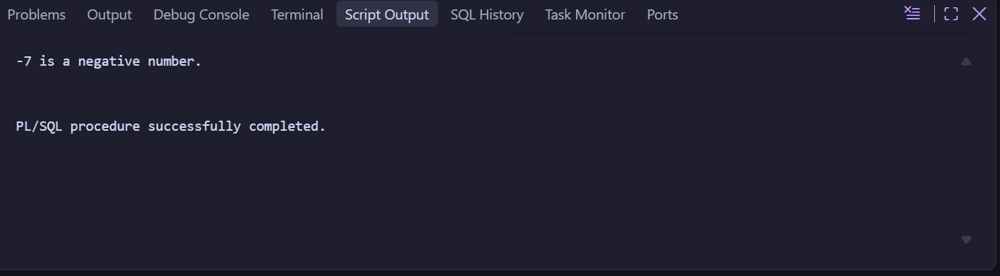
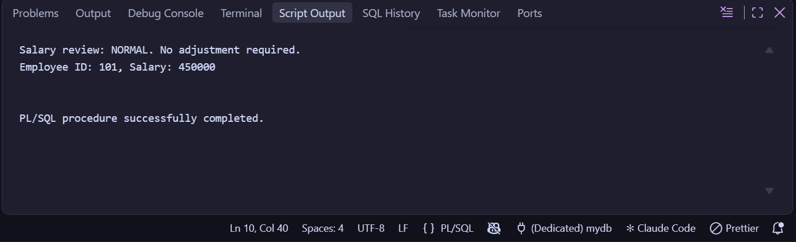
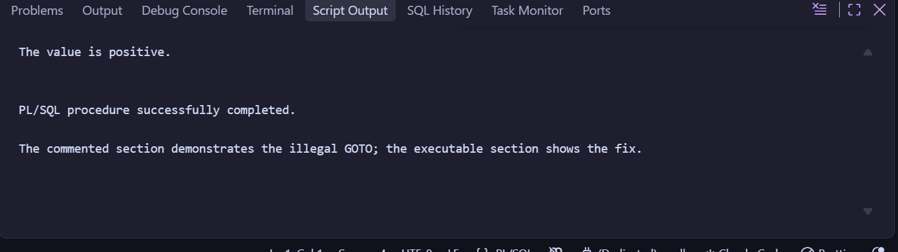
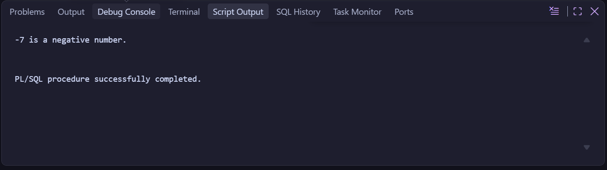
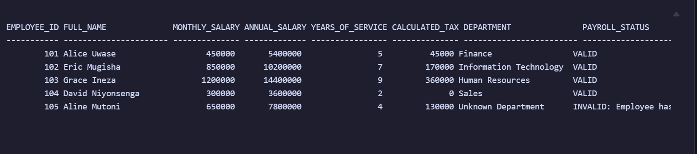
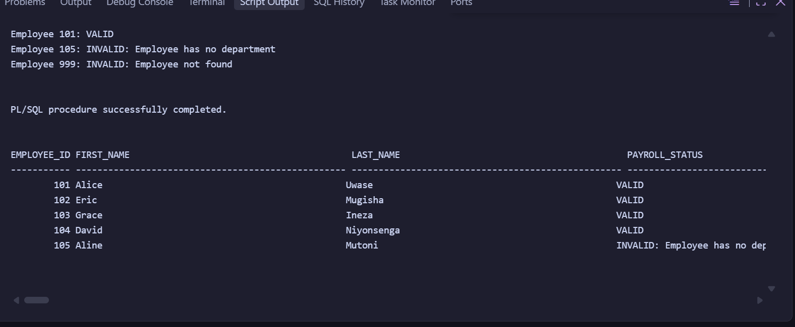

# Individual Assignment III: PL/SQL GOTO Statements and Functions

This repository contains my individual practical assignment on PL/SQL `GOTO` statements, stored functions, exception handling, and functions used in SQL queries.

## Repository Structure

```text
plsql-goto-functions-20251SEN076-Davy/
├── README.md
├── .gitignore
├── 00_setup/
│   └── create_tables.sql
├── 01_goto/
│   ├── A1_number_classifier.sql
│   ├── A2_salary_review.sql
│   ├── A3_illegal_goto.sql
│   └── A4_rewrite_no_goto.sql
├── 02_functions/
│   ├── B1_fn_annual_salary.sql
│   ├── B2_fn_years_of_service.sql
│   ├── B3_fn_calculate_tax.sql
│   ├── B4_fn_dept_name.sql
│   └── C1_fn_validate_payroll.sql
├── 03_tests/
│   ├── B5_functions_in_select.sql
│   ├── test_functions.sql
│   └── test_validate_payroll.sql
├── screenshots/
│   ├── A1_output.png
│   ├── A2_output.png
│   ├── A3_error_and_fix.png
│   ├── A4_output.png
│   ├── B5_select_output.png
│   └── C1_output.png
└── docs/
    └── REFLECTION.md
```

## Requirements

* Oracle Database
* SQL*Plus, SQLcl, Oracle SQL Developer, VS Code Oracle Extension, or another Oracle client
* `SERVEROUTPUT` enabled for PL/SQL output

## How to Run

Run the scripts in the following order:

1. `00_setup/create_tables.sql`
2. All function scripts in `02_functions/`
3. All GOTO scripts in `01_goto/`
4. Test scripts in `03_tests/`
5. Capture the required screenshots and save them in `screenshots/`

Example in SQL*Plus or SQLcl:

```sql
@00_setup/create_tables.sql

@02_functions/B1_fn_annual_salary.sql
@02_functions/B2_fn_years_of_service.sql
@02_functions/B3_fn_calculate_tax.sql
@02_functions/B4_fn_dept_name.sql
@02_functions/C1_fn_validate_payroll.sql

@01_goto/A1_number_classifier.sql
@01_goto/A2_salary_review.sql
@01_goto/A3_illegal_goto.sql
@01_goto/A4_rewrite_no_goto.sql

@03_tests/test_functions.sql
@03_tests/B5_functions_in_select.sql
@03_tests/test_validate_payroll.sql
```

## Assignment Parts

### Part A: GOTO

* A1: Number classifier using labels and `GOTO`
* A2: Employee salary review using `GOTO`
* A3: Illegal `GOTO` example and corrected implementation
* A4: Rewrite a GOTO-based solution using structured control flow

### Part B: Functions

* B1: Annual salary function
* B2: Years-of-service function
* B3: Tax-calculation function
* B4: Department-name lookup function with exception handling
* B5: Use stored functions in a SQL `SELECT` statement

### Part C: Combined Task

* C1: Payroll validation function
* C2: Reflection in `docs/REFLECTION.md`

## Screenshots

### A1 - Number Classifier



### A2 - Salary Review



### A3 - Illegal GOTO and Fix



### A4 - Rewrite Without GOTO



### B5 - Functions in SQL



### C1 - Payroll Validator



## Notes

AI was used for generating dummy data and for suggesting Git commit message wording using GitHub Copilot.

